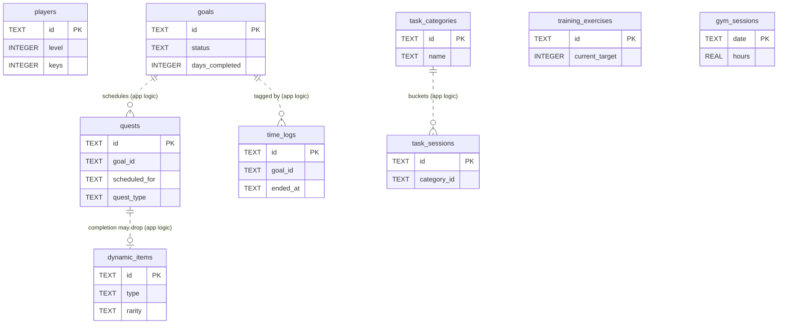

# SystemOS Database Architecture

SystemOS has **two** SQLite databases:

| Database | Location | Role |
|---|---|---|
| **Device DB** (`systemos.db`) | On-device, via `expo-sqlite` | Source of truth for all gameplay state |
| **Backend DB** (SQLite locally, Neon Postgres in the cloud) | Server, via SQLAlchemy Core | User accounts + per-user seed/profile state |

The device database is the store of record. The backend database exists to support
sign-in and to seed a new install; it does not hold campaign progress, training history,
focus logs, or the Hunter Log.

> Earlier revisions of this document stated the backend holds no persistent data. That
> changed when JWT auth was added — see [Backend database](#backend-database).

---

## Device database

Opened as a WAL-mode singleton in `mobile/src/data/database/db.ts`. The schema is plain
SQL executed on every open (`CREATE TABLE IF NOT EXISTS`) — there is **no migration
framework** and **no foreign-key constraints**. Tables are linked by application logic
only.

### Table catalog

| Table | Purpose | Created by |
|---|---|---|
| `players` | Singleton Hunter: 8 stats, level/XP, bio, aspirations, rank, keys | `schema.ts` |
| `goals` | Goal campaigns: timeline bounds, plan, schedule, completed-day counter | `schema.ts` |
| `quests` | Dated campaign quests and dungeon quests | `schema.ts` |
| `dynamic_items` | Earned real-world reward coupons | `schema.ts` |
| `shadow_soldiers` | **Dead schema** — no repository, store, model, or UI | `schema.ts` |
| `training_exercises` | Exercise baselines, progression targets, completion history | `schema.ts` |
| `gym_sessions` | Self-reported gym hours per day | `schema.ts` |
| `time_logs` | Focus-timer sessions (one row per measured session) | `schema.ts` |
| `task_categories` | Hunter Log buckets on the Dashboard | `schema.ts` |
| `task_sessions` | Hand-entered time logged against a category | `schema.ts` |
| `app_meta` | Key-value app state (timeline cursor, notification dedup) | `AppMeta.ts` |
| `mutation_queue` | Offline-queued API calls pending replay — **currently unused** | `MutationQueue.ts` |

`app_meta` and `mutation_queue` self-create in their owning service modules rather than
in the central schema, keeping their lifecycle next to the only code that uses them.

---

### `players`

Effectively a singleton — the app maintains one row.

| Column | Type | Default | Notes |
|---|---|---|---|
| `id` | TEXT | — | PRIMARY KEY |
| `name` | TEXT | — | |
| `level` | INTEGER | `1` | |
| `experience` | INTEGER | `0` | |
| `experience_to_next_level` | INTEGER | `100` | Grows ×1.5 per level (app logic) |
| `strength` … `mindfulness` | INTEGER | `10` | Eight separate columns, one per attribute |
| `bio` | TEXT | — | Nullable; free-form life context for AI personalization |
| `aspirations` | TEXT | `''` | Added by migration |
| `model_preference` | TEXT | `'local'` | `'local'` or `'cloud'` (not enforced) |
| `rank` | TEXT | `'E-Rank'` | Hunter Rank, added by migration |
| `keys` | INTEGER | `0` | Dungeon keys, added by migration |

The eight attribute columns are assembled into a `stats` object by the repository mapper.

### `goals`

| Column | Type | Default | Notes |
|---|---|---|---|
| `id` | TEXT | — | PRIMARY KEY |
| `title` | TEXT | — | |
| `description` | TEXT | `''` | |
| `context` | TEXT | `''` | Free-form life context that shaped the plan |
| `duration_days` | INTEGER | `1` | |
| `start_date` | TEXT | — | `YYYY-MM-DD`, day 1 |
| `end_date` | TEXT | — | `YYYY-MM-DD`, day N |
| `plan` | TEXT | `''` | Stage-1 strategy (prose) |
| `schedule` | TEXT | `''` | Stage-2 day-by-day blueprint (prose) |
| `days_completed` | INTEGER | `0` | Drives dungeon-key milestones |
| `status` | TEXT | `'active'` | `active` / `completed` / `abandoned` |
| `created_at` | TEXT | — | ISO-8601 |

### `quests`

| Column | Type | Default | Notes |
|---|---|---|---|
| `id` | TEXT | — | PRIMARY KEY |
| `title` | TEXT | — | |
| `description` | TEXT | `''` | |
| `category` | TEXT | — | Usually an attribute name (not enforced) |
| `difficulty` | TEXT | `'E'` | E → S (not enforced) |
| `xp_reward` | INTEGER | `0` | |
| `gold_reward` | INTEGER | `0` | |
| `is_completed` | INTEGER | `0` | Boolean 0/1 |
| `created_at` | TEXT | — | ISO-8601 |
| `completed_at` | TEXT | — | Nullable |
| `goal_id` | TEXT | — | Logical link to `goals.id`; added by migration |
| `scheduled_for` | TEXT | — | `YYYY-MM-DD` — the day the quest is revealed |
| `quest_type` | TEXT | `'daily'` | `daily` or `dungeon` |
| `dungeon_challenge` | TEXT | — | **JSON** — only when `quest_type = 'dungeon'` |
| `dungeon_result` | TEXT | — | **JSON** — set after the player self-reports |
| `accepted_at` | TEXT | — | ISO-8601; null until the player accepts |

### `dynamic_items`

Reward coupons. Rarity scales how generous the real-world indulgence is.

| Column | Type | Default | Notes |
|---|---|---|---|
| `id` | TEXT | — | PRIMARY KEY |
| `type` | TEXT | `'token'` | `token` / `potion` / `weapon` (legacy); added by migration |
| `name` | TEXT | — | |
| `description` | TEXT | — | The indulgence and its amount/duration |
| `rarity` | TEXT | `'Common'` | Common / Rare / Epic / Legendary |
| `stat_modifiers` | TEXT | `'{}'` | **Legacy** — retained, no longer read |
| `special_effect` | TEXT | — | **Legacy** — retained, no longer read |
| `is_equipped` | INTEGER | `0` | **Legacy** — retained, no longer read |

The last three columns survive from the retired stat-gear model. The current
`DynamicItem` domain model ignores them; they are kept so existing installs don't lose
rows to a destructive migration.

### `training_exercises`

| Column | Type | Default | Notes |
|---|---|---|---|
| `id` | TEXT | — | PRIMARY KEY |
| `name` | TEXT | — | |
| `muscle_group` | TEXT | — | |
| `mode` | TEXT | — | `reps` or `seconds` |
| `baseline` | INTEGER | — | Starting capability |
| `current_target` | INTEGER | — | Today's target |
| `max_target` | INTEGER | — | Progression ceiling |
| `step_index` | INTEGER | `0` | Position on the progression ladder |
| `days_trained` | INTEGER | `0` | |
| `last_completed_date` | TEXT | — | Nullable |
| `created_at` | TEXT | — | ISO-8601 |

### `gym_sessions`

| Column | Type | Default | Notes |
|---|---|---|---|
| `date` | TEXT | — | **PRIMARY KEY** — `YYYY-MM-DD`, one row per day |
| `hours` | REAL | `0` | |
| `xp_awarded` | INTEGER | `0` | |
| `created_at` | TEXT | — | ISO-8601 |

Keyed by date so a day can be revised in place rather than duplicated.

### `time_logs`

Focus-timer sessions. Unlike `gym_sessions` (one self-reported row per day), this is one
row per measured session.

| Column | Type | Default | Notes |
|---|---|---|---|
| `id` | TEXT | — | PRIMARY KEY |
| `date` | TEXT | — | Local `YYYY-MM-DD`, fixed from `started_at` at insert |
| `description` | TEXT | `''` | |
| `description_source` | TEXT | `'manual'` | `manual` / `campaign` / `ai` |
| `goal_id` | TEXT | — | Tagged campaign, or null |
| `quest_id` | TEXT | — | Provenance only; nothing writes back |
| `started_at` | TEXT | — | ISO-8601 |
| `ended_at` | TEXT | — | **null ⇒ this row is the running timer** |
| `seconds` | INTEGER | `0` | Raw measured elapsed; 0 while running |
| `credited_seconds` | INTEGER | `0` | After session + daily clamps; XP is paid on this |
| `xp_awarded` | INTEGER | `0` | |
| `created_at` | TEXT | — | ISO-8601 |

Index: `idx_time_logs_date (date)`.

**Key invariant:** at most one row has `ended_at IS NULL`, and that row *is* the running
timer. Elapsed is always derived from `started_at` — never stored or ticked — so a
session survives app kill, backgrounding, and re-renders.

### `task_categories`

| Column | Type | Default | Notes |
|---|---|---|---|
| `id` | TEXT | — | PRIMARY KEY |
| `name` | TEXT | — | User-named bucket: "Coding", "Gym" |
| `icon` | TEXT | `'⏱️'` | A single emoji — the app has no icon font |
| `sort_order` | INTEGER | `0` | |
| `source` | TEXT | — | Links the bucket to another subsystem's time; added by migration |
| `created_at` | TEXT | — | ISO-8601 |

Three defaults are seeded on first launch. Totals are **never** stored here — they are
summed from `task_sessions` on read.

**`source` and the Hunter Log as a view.** The Dashboard shows time from three
different tables. `source` is the link that makes that possible without duplicating rows:

| `source` | Meaning |
|---|---|
| `NULL` | Plain hand-entry bucket — `task_sessions` only |
| `'gym'` | Also absorbs all `gym_sessions` hours logged in the Army tab |

The merge happens **on read**, in `useTaskLogStore.refreshSummary()` — never by copying
rows into `task_sessions`. Gym hours and focus sessions already awarded XP when they were
recorded, so writing them through would pay for the same time twice.

Focus-timer time (`time_logs`) has no bucket of its own. The store appends a **synthetic**
summary row (id `__focus__`, `synthetic: true`) that has no `task_categories` record;
it is read-only and hidden when its total is zero.

The seeded Gym category is created with `source = 'gym'`. Installs seeded before the
column existed are backfilled by migration (`WHERE source IS NULL AND name = 'Gym'`), so
a later rename or deliberate unlink is never re-applied.

### `task_sessions`

| Column | Type | Default | Notes |
|---|---|---|---|
| `id` | TEXT | — | PRIMARY KEY |
| `category_id` | TEXT | — | Logical link to `task_categories.id` |
| `date` | TEXT | — | Local `YYYY-MM-DD` |
| `minutes` | INTEGER | — | Hand-entered |
| `note` | TEXT | `''` | |
| `xp_awarded` | INTEGER | `0` | |
| `created_at` | TEXT | — | ISO-8601 |

Indexes: `idx_task_sessions_category (category_id, created_at)`,
`idx_task_sessions_date (date)`.

Because these are self-reported rather than clocked, they are defended by a per-session
ceiling and a daily cap instead of by a timer.

### `shadow_soldiers`

| Column | Type | Default |
|---|---|---|
| `id` | TEXT | — |
| `name` | TEXT | — |
| `type` | TEXT | — |
| `level` | INTEGER | `1` |
| `experience` | INTEGER | `0` |
| `streak` | INTEGER | `0` |
| `last_check_in` | TEXT | — |

**Dead schema.** The table is created and is included in the Settings "SCRAM" wipe list,
but nothing reads or writes it: there is no repository, store, domain model, or UI. The
Army tab implements training, not a Shadow Army. Keep or drop it deliberately — see
SYS-017 in [`issue.md`](../issue.md).

### `app_meta`

Source: `mobile/src/data/services/AppMeta.ts`

| Column | Type | Notes |
|---|---|---|
| `key` | TEXT | PRIMARY KEY |
| `value` | TEXT | Written via `INSERT OR REPLACE` |

Holds the timeline cursor, `last_daily_notification_date` (notification dedup), and
penalty notices. `DailyTimelineService` is the single owner of day advancement and
notification deduplication; the old `DailyResetService` was deleted.

### `mutation_queue`

Source: `mobile/src/data/database/MutationQueue.ts`

| Column | Type | Notes |
|---|---|---|
| `id` | INTEGER | PRIMARY KEY AUTOINCREMENT — the only autoincrement table |
| `type` | TEXT | Mutation kind |
| `payload` | TEXT | **JSON** — stringified mutation args |
| `created_at` | TEXT | ISO-8601; replay order is `created_at ASC` |

**Currently unused.** No module outside `MutationQueue.ts` references it — the current
reward flow writes the fallback coupon locally instead of queuing a replay. Tracked as
SYS-008.

---

## Relationships

There are **no foreign-key constraints**. Every link below is logical, enforced by
repository and service code.

- `players` is a singleton, so no table carries a `player_id`.
- A completed quest may produce a `dynamic_items` row, but no column ties the item back
  to the quest.
- `time_logs.goal_id` is nullable and detachable — see `detachGoal`.

---

## Conventions

- **Primary keys** — `TEXT` UUID-style ids, except `gym_sessions` (natural date key),
  `app_meta` (natural string key), and `mutation_queue` (`INTEGER AUTOINCREMENT`).
- **Booleans** — `INTEGER` 0/1 (`is_completed`, `is_equipped`).
- **Timestamps** — `TEXT` ISO-8601. Date-only fields are local `YYYY-MM-DD`, computed in
  local time so a day boundary matches the user's own midnight.
- **JSON columns** — `TEXT` holding `JSON.stringify`'d data (`dungeon_challenge`,
  `dungeon_result`, `stat_modifiers`, `special_effect`, `mutation_queue.payload`), parsed
  in repository mappers.
- **Table creation** — idempotent, run on every open.
- **Migrations** — no framework. Additive `ALTER TABLE … ADD COLUMN` in `db.ts` wrapped
  in try/catch, since SQLite has no `ADD COLUMN IF NOT EXISTS`. Current migrations add
  `players.aspirations`, `players.rank`, `players.keys`, `quests.goal_id`,
  `quests.scheduled_for`, `quests.quest_type`, `quests.dungeon_challenge`,
  `quests.dungeon_result`, `quests.accepted_at`, `dynamic_items.type`, and
  `task_categories.source` (plus its one-time `UPDATE` backfill for the Gym bucket —
  the only non-`ALTER` statement in the list, and idempotent by design).
- **Connection** — single shared handle via `getDb()`, `PRAGMA journal_mode = WAL`.

**Never write a destructive migration.** Existing installs hold the only copy of a user's
progress; there is no server-side backup of gameplay state.

---

## Backend database

Source: `backend/app/db.py` — SQLAlchemy Core, no ORM. `DATABASE_URL` (read in
`app/config.py`) picks the engine:

- **Local (default):** SQLite file at `backend/systemos.db` (gitignored), WAL enabled.
- **Cloud (Cloud Run and Vercel share one):** Neon Postgres via `psycopg` 3, pooled
  connection string, `pool_pre_ping`, and prepared statements disabled for Neon's
  PgBouncer pooler.

The engine is created lazily on first use, never at import. Every public function is
`async` and runs its blocking query in a worker thread. Tables are created with
`metadata.create_all` (idempotent, never alters an existing table — adopt Alembic before
the first schema change).

### `users`

| Column | Type | Notes |
|---|---|---|
| `id` | TEXT | PRIMARY KEY — UUID4 |
| `email` | TEXT | Stored lower-cased; unique index `ux_users_email` (case-insensitive by normalization, on both engines). Pre-2026-10-31 local SQLite files keep the older `UNIQUE COLLATE NOCASE` column, which behaves the same |
| `password_hash` | TEXT | bcrypt |
| `name` | TEXT | Nullable |
| `created_at` | TEXT | ISO-8601 UTC |

### `user_state`

| Column | Type | Notes |
|---|---|---|
| `user_id` | TEXT | PRIMARY KEY, `REFERENCES users(id)` |
| `player_json` | TEXT | **JSON** |
| `quests_json` | TEXT | **JSON** |
| `inventory_json` | TEXT | **JSON** |
| `updated_at` | TEXT | ISO-8601 UTC |

Seeded at signup from the `DEFAULT_*_STATE` templates in `main.py`; the user row and its
state row are inserted in a single transaction. Every read and write goes through
`get_user_state()` / `save_user_state()`, so state is per-user, not shared.

### Design decisions

- **Device SQLite as source of truth** — the app functions with no backend, and the
  device owns gameplay data.
- **JSON blobs server-side** — the backend does not query into player state, so
  normalizing it would add schema churn for no benefit. The device holds the structured
  copy.
- **No foreign keys on the device** — a singleton player makes per-row ownership columns
  unnecessary, keeping the schema flat and migrations simple.
- **JSON-in-TEXT for variable shapes** — dungeon challenges and results have open-ended
  structure that would be awkward to normalize.
