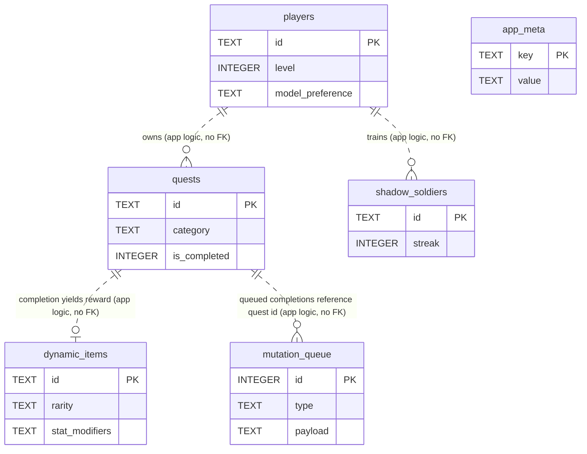

# SystemOS Database Architecture

SystemOS uses a **device-side SQLite database** (`systemos.db`) accessed through
`expo-sqlite`, opened as a WAL-mode singleton in
`mobile/src/data/database/db.ts`. All player data lives locally on the device — this
is the app's privacy-first, offline-first store of record. The FastAPI backend holds
**no persistent data** (in-memory mock state only), so this document covers the SQLite
schema exclusively. The core principle: the local database is the engine; the UI and
backend are replaceable around it.

The schema is plain SQL executed on first open — there is **no migration framework**
and **no foreign-key constraints**; tables are linked only by application logic.

## Table Catalog

| Table | Purpose | Source file |
|---|---|---|
| `players` | Single player profile: stats (8 attributes), level/XP, bio, aspirations, model preference | `mobile/src/data/database/schema.ts` |
| `quests` | Active quests — title, category, difficulty, rewards, completion state | `mobile/src/data/database/schema.ts` |
| `dynamic_items` | AI-generated reward items — rarity, stat modifiers, special effect | `mobile/src/data/database/schema.ts` |
| `shadow_soldiers` | Habit tracking ("Shadow Army") — streak, level, check-ins | `mobile/src/data/database/schema.ts` |
| `mutation_queue` | Offline-queued API calls pending replay when back online | `mobile/src/data/database/MutationQueue.ts` |
| `app_meta` | Key-value store for app state (e.g. last quest reset date) | `mobile/src/data/services/DailyResetService.ts` |

> The first four tables are created centrally from `CREATE_TABLES_SQL` in `schema.ts`.
> `mutation_queue` and `app_meta` are created lazily by their own service modules
> (`ensureTable()` / `ensureMetaTable()`) the first time they are used — they are
> **not** in the central schema file.

## Tables

### `players`
Source: `mobile/src/data/database/schema.ts`

| Column | Type | Nullable | Default | Notes |
|---|---|---|---|---|
| `id` | TEXT | No | — | PRIMARY KEY |
| `name` | TEXT | No | — | |
| `level` | INTEGER | No | `1` | |
| `experience` | INTEGER | No | `0` | |
| `experience_to_next_level` | INTEGER | No | `100` | Grows ×1.5 per level (app logic) |
| `strength` | INTEGER | No | `10` | One of the 8 attributes |
| `agility` | INTEGER | No | `10` | |
| `stamina` | INTEGER | No | `10` | |
| `intelligence` | INTEGER | No | `10` | |
| `perception` | INTEGER | No | `10` | |
| `discipline` | INTEGER | No | `10` | |
| `creativity` | INTEGER | No | `10` | |
| `mindfulness` | INTEGER | No | `10` | |
| `bio` | TEXT | Yes | — | |
| `aspirations` | TEXT | Yes | `''` | Also added via `ALTER TABLE` migration in `db.ts` for pre-existing DBs |
| `model_preference` | TEXT | No | `'local'` | `'local'` or `'cloud'` (not constraint-enforced) |

Effectively a singleton — the app maintains one player row.

### `quests`
Source: `mobile/src/data/database/schema.ts`

| Column | Type | Nullable | Default | Notes |
|---|---|---|---|---|
| `id` | TEXT | No | — | PRIMARY KEY |
| `title` | TEXT | No | — | |
| `description` | TEXT | No | `''` | |
| `category` | TEXT | No | — | One of the 8 attributes (not enforced) |
| `difficulty` | TEXT | No | `'E'` | E → S rank (not enforced) |
| `xp_reward` | INTEGER | No | `0` | |
| `gold_reward` | INTEGER | No | `0` | |
| `is_completed` | INTEGER | No | `0` | Boolean (0/1) |
| `created_at` | TEXT | No | — | ISO-8601 timestamp |
| `completed_at` | TEXT | Yes | — | ISO-8601; null until completed |

### `dynamic_items`
Source: `mobile/src/data/database/schema.ts`

| Column | Type | Nullable | Default | Notes |
|---|---|---|---|---|
| `id` | TEXT | No | — | PRIMARY KEY |
| `name` | TEXT | No | — | |
| `description` | TEXT | No | — | |
| `rarity` | TEXT | No | `'Common'` | Common / Rare / Epic / Legendary (not enforced) |
| `stat_modifiers` | TEXT | No | `'{}'` | **JSON** — `JSON.stringify`'d stat map |
| `special_effect` | TEXT | Yes | — | **JSON** — only present for Epic+ items |
| `is_equipped` | INTEGER | No | `0` | Boolean (0/1) |

### `shadow_soldiers`
Source: `mobile/src/data/database/schema.ts`

| Column | Type | Nullable | Default | Notes |
|---|---|---|---|---|
| `id` | TEXT | No | — | PRIMARY KEY |
| `name` | TEXT | No | — | |
| `type` | TEXT | No | — | Habit type |
| `level` | INTEGER | No | `1` | |
| `experience` | INTEGER | No | `0` | |
| `streak` | INTEGER | No | `0` | Consecutive check-in count |
| `last_check_in` | TEXT | Yes | — | ISO-8601; null until first check-in |

### `mutation_queue`
Source: `mobile/src/data/database/MutationQueue.ts`

| Column | Type | Nullable | Default | Notes |
|---|---|---|---|---|
| `id` | INTEGER | No | AUTOINCREMENT | PRIMARY KEY (only autoincrement table) |
| `type` | TEXT | No | — | Mutation kind — currently `'COMPLETE_QUEST'` |
| `payload` | TEXT | No | — | **JSON** — `JSON.stringify`'d mutation args |
| `created_at` | TEXT | No | — | ISO-8601; replay order is `created_at ASC` |

### `app_meta`
Source: `mobile/src/data/services/DailyResetService.ts`

| Column | Type | Nullable | Default | Notes |
|---|---|---|---|---|
| `key` | TEXT | No | — | PRIMARY KEY (e.g. `last_quest_reset_date`) |
| `value` | TEXT | No | — | Stringified value; written via `INSERT OR REPLACE` |

## Relationships

There are **no foreign-key constraints** in the schema. Every table stands alone at
the database level; the links below are **logical only**, enforced by application code
rather than the DB.

- `players` is a singleton; `quests`, `dynamic_items`, and `shadow_soldiers` are
  implicitly "owned" by that one player — there is no `player_id` column on them.
- Completing a quest generates a `dynamic_items` row, but no column ties the item back
  to the originating quest.
- `mutation_queue.payload` carries a quest id inside its JSON, but it is not a DB
  reference.

## Conventions

- **Primary keys**: `TEXT` UUID-style ids for domain tables; `app_meta` uses a `TEXT`
  natural key; `mutation_queue` is the lone `INTEGER PRIMARY KEY AUTOINCREMENT`.
- **Booleans**: stored as `INTEGER` 0/1 (`is_completed`, `is_equipped`).
- **Timestamps**: `TEXT` ISO-8601 strings (`created_at`, `completed_at`,
  `last_check_in`).
- **JSON columns**: stored as `TEXT` holding `JSON.stringify`'d data
  (`stat_modifiers`, `special_effect`, `mutation_queue.payload`) and parsed in
  repository mappers.
- **Table creation**: idempotent `CREATE TABLE IF NOT EXISTS`, run on every DB open.
  Core tables from `schema.ts`; queue/meta tables self-create in their services.
- **Migrations**: no framework. Column additions use `ALTER TABLE … ADD COLUMN`
  wrapped in try/catch (SQLite lacks `IF NOT EXISTS` for columns) — see the
  `aspirations` migration in `db.ts`.
- **Connection**: single shared handle (`getDb()`), `PRAGMA journal_mode = WAL`.

## Design Decisions

- **Local SQLite as source of truth** — supports the privacy-first, offline-first
  principle; the device owns all data and the app functions with no backend.
- **No foreign keys / no `player_id`** — the app is single-player, so a singleton
  `players` row makes per-row ownership columns unnecessary; relationships stay in
  application logic, keeping the schema flat and migration-free.
- **JSON-in-TEXT for variable shapes** — `stat_modifiers`, `special_effect`, and
  mutation payloads have open-ended structure that would be awkward to normalize, so
  they are serialized and parsed at the repository boundary.
- **Offline mutation queue** — `mutation_queue` lets quest completions that fail
  offline be replayed in `created_at` order when connectivity returns, decoupling user
  actions from network availability.
- **Lazy queue/meta tables** — `mutation_queue` and `app_meta` self-create in their
  owning services, keeping their lifecycle next to the only code that uses them.
