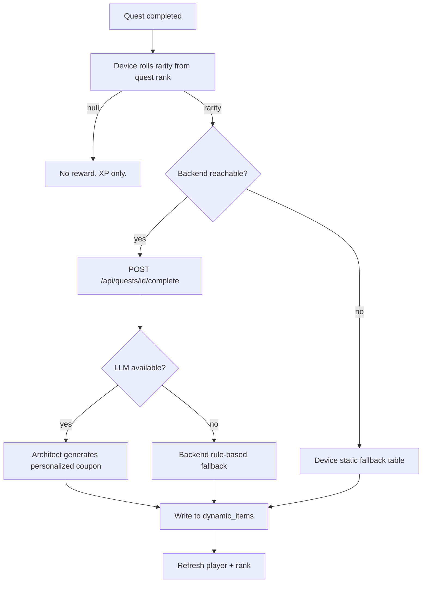

# Reward System

Completing a quest can drop a reward. A reward is a **real-world indulgence coupon** —
permission to enjoy something you'd otherwise feel guilty about — not stat gear.

> **Model change.** This document previously described AI-generated fantasy equipment
> with stat modifiers and special effects. That model was retired. The columns still
> exist in `dynamic_items` for backward compatibility but nothing reads them. See
> [`DOMAIN_MODELS.md`](DOMAIN_MODELS.md).

---

## The two reward classes

| Type | Meaning | Examples |
|---|---|---|
| `token` | An **active** leisure or social permission | gaming, calling a friend, a snack, an episode, a hobby session |
| `potion` | **Rest** and self-care | a nap, a long sleep, a relaxing bath, a quiet unplug |

A third type, `weapon`, exists only to cover legacy rows written before the coupon
system. Nothing generates it now.

### Rarity scales generosity

Rarity does not make an item "more powerful" — it decides how generous the indulgence is.
Rewards are meant to feel *earned*, so the amounts stay deliberately lean.

| Rarity | Size | Typical amount |
|---|---|---|
| Common | tiny | ~10 minutes, or one small treat |
| Rare | small | ~20 minutes |
| Epic | moderate | ~30–40 minutes |
| Legendary | generous | ~60 minutes, or one full night's unbroken rest |

Every generated description must name **both** the real activity and its concrete
amount or duration.

---

## Drop odds

Source of truth: `RANK_DROP_ODDS` in `mobile/src/data/services/RewardService.ts`. The
**device** owns the roll — it decides whether anything drops and at what rarity, then
tells the backend which rarity to write for.

The rank of the *completed quest* steers the roll. Higher rank means fewer empty rolls
and a split shifted toward Epic and Legendary.

| Quest rank | No reward | Legendary | Epic | Rare | Common (remainder) |
|---|---|---|---|---|---|
| E | 55% | 2% | 6% | 22% | 70% |
| D | 45% | 7% | 11% | 24% | 58% |
| C | 36% | 12% | 16% | 27% | 45% |
| B | 27% | 17% | 23% | 28% | 32% |
| A | 18% | 23% | 27% | 29% | 21% |
| S | 8% | 28% | 32% | 30% | 10% |

The rarity columns are conditional on a drop occurring. Common is always the remainder,
so the four rarity values sum to 1 at every rank.

**Invariants** — hold these when tuning:

- `noReward` falls strictly from E to S.
- `legendary`, `epic`, and `rare` each rise strictly from E to S.
- `legendary + epic + rare ≤ 1` at every rank, so Common never goes negative.
- E anchors the low end (the original fixed odds); S anchors the top end. D–A interpolate.

```ts
export function rollRewardRarity(rank: Rank): Rarity | null {
  const odds = RANK_DROP_ODDS[rank] ?? RANK_DROP_ODDS.E;
  if (Math.random() < odds.noReward) return null;
  const r = Math.random();
  if (r < odds.legendary) return 'Legendary';
  if (r < odds.legendary + odds.epic) return 'Epic';
  if (r < odds.legendary + odds.epic + odds.rare) return 'Rare';
  return 'Common';
}
```

---

## Generation flow



The device rolls first and passes the chosen rarity in the request body, so the reward
the player is shown always matches the roll the device made — a slow or failed backend
changes the *flavor* of the coupon, never its rarity.

---

## Fallback chain

Three tiers, each degrading in place rather than failing:

1. **AI-generated** — the Architect personalizes the coupon to the player's bio and the
   quest category.
2. **Backend rule-based** — `synthesize_fallback_reward()` when the LLM call fails or no
   provider is configured. The endpoint still returns HTTP 200.
3. **Device static table** — `RewardService.getFallbackReward()` when the backend is
   unreachable entirely.

### Device fallback table

Source: `FALLBACK_TABLE` in `RewardService.ts`, keyed by quest category.

| Category | Type | Name | Indulgence |
|---|---|---|---|
| `stamina`, `agility` | token | Token of Leisure | 10 minutes on a hobby, purely for joy |
| `strength` | token | Token of Indulgence | A favorite snack or treat |
| `intelligence` | potion | Potion of Stillness | 10 minutes away from the screen |
| `discipline` | token | Token of Gaming | 10 guilt-free minutes of your favorite game |
| `creativity` | token | Token of Leisure | 10 minutes creating something for fun |
| `perception` | token | Token of Friendship | Call or message a friend for 10 minutes |
| `mindfulness` | potion | Potion of Sleep | A 10-minute nap or quiet unplug |

Lookup is case-insensitive with an exact match first, then a substring match, then
`DEFAULT_FALLBACK` (*Potion of Respite* — "a guilt-free 10-minute break to do whatever
restores you").

The static entries are written at Common size (~10 minutes) but are stamped with whatever
rarity the device rolled, so an offline Legendary still reads as Legendary.

---

## Output schema

The Architect returns exactly this shape (`RewardOutput` in `reward_generator.py`),
validated by a `JsonOutputParser`:

```json
{
  "type": "token|potion",
  "name": "string",
  "description": "string",
  "rarity": "Common|Rare|Epic|Legendary"
}
```

Invariants are re-enforced in Python after parsing, because models drift from
instructions: `type` is coerced to `token`/`potion`, and `rarity` to the rolled value.

Example:

```json
{
  "type": "token",
  "name": "Token of Gaming",
  "description": "You have earned forty uninterrupted minutes in the game you have been putting off — no guilt, no clock-watching.",
  "rarity": "Epic"
}
```

---

## Design rationale

**Why coupons instead of stat gear.** Stat items create a second, fake economy: numbers
that only matter inside the app. A coupon cashes out into the player's real life, which
is the thing the app is actually trying to change. It also sidesteps balance work — there
is no power curve to tune.

**Why the device owns the roll.** Rarity must be decided before the network call so the
reward is identical online and offline. It also means a flaky backend can never inflate
or deflate drop rates.

**Why rewards stay lean.** A reward that is too generous stops reading as earned. Ten
minutes that you genuinely gave yourself permission for is worth more than an hour you'd
have taken anyway.

**Why three fallback tiers.** Each layer owns the failure it can actually see: the device
knows about connectivity, the backend knows about provider health. Both degrade to
something real rather than an error state, so the player is never left empty-handed.
