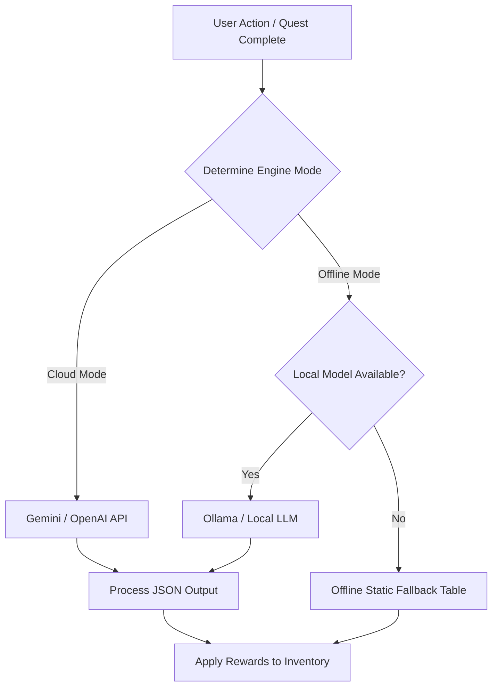

# AI-Driven Contextual Reward System

This document describes the design, mechanics, and integration of the context-aware Reward System in SystemOS.

---

## Overview

Traditional productivity applications offer generic rewards (such as XP or standard coins). SystemOS gamifies life by generating **highly personalized items and stats** tailored to the user's real-life circumstances and goals. 

For example:
* **User Context**: *"I travel frequently for work and have a partner."*
* **Dynamic Reward**: 
  * **Item**: *Amulet of the Wandering Partner*
  * **Stats**: +5 Perception (from travel), +5 Mindfulness (for maintaining relationship balance).
  * **Lore/Flavor**: *"A small locket that hums with warmth, no matter how many miles you are from home."*

---

## Core Flow Architecture



---

## User Context Profile

The context is stored in a clean, open-ended format inside the user's local database. It is composed of:
1. **Open-Ended Biography**: A raw description of the user's current situation (e.g., job, relationship status, hobbies, fears, ambitions).
2. **Dynamic Tags**: Derived automatically from the user's active Quest Dungeons (e.g., `dungeon:fitness`, `dungeon:coding`).
3. **Model Preference Toggle**:
   * `cloud`: Prioritizes high-quality narrative lore and complex item effects using cloud models.
   * `local`: Uses offline local models to prioritize absolute privacy and data ownership.

---

## Structured Output Schema

To integrate with the Core Engine, the AI model must strictly return a structured JSON response matching this schema:

```json
{
  "$schema": "http://json-schema.org/draft-07/schema#",
  "type": "object",
  "properties": {
    "name": {
      "type": "string",
      "description": "Unique, contextually-relevant name for the item."
    },
    "description": {
      "type": "string",
      "description": "Lore or flavor text describing the item."
    },
    "rarity": {
      "type": "string",
      "enum": ["Common", "Rare", "Epic", "Legendary"]
    },
    "stat_modifiers": {
      "type": "object",
      "properties": {
        "strength": { "type": "integer" },
        "agility": { "type": "integer" },
        "stamina": { "type": "integer" },
        "intelligence": { "type": "integer" },
        "perception": { "type": "integer" },
        "discipline": { "type": "integer" },
        "creativity": { "type": "integer" },
        "mindfulness": { "type": "integer" }
      },
      "additionalProperties": false
    },
    "special_effect": {
      "type": "object",
      "properties": {
        "name": { "type": "string" },
        "trigger": { "type": "string", "description": "When does this effect activate?" },
        "description": { "type": "string", "description": "What is the gameplay benefit?" }
      },
      "required": ["name", "trigger", "description"],
      "additionalProperties": false
    }
  },
  "required": ["name", "description", "rarity", "stat_modifiers", "special_effect"],
  "additionalProperties": false
}
```

---

## Caching & Fallback Policies

Generating dynamic items on every single quest completion is computationally expensive and can feel overwhelming. SystemOS mitigates this with the following rules:

### 1. Daily/Weekly Batch Generation
Instead of on-demand generation per quest, the **Architect** pre-generates a set of context-aligned items (the "Weekly Loot Pool") during the weekly reset. Completing quests rewards the user with loot boxes or keys that draw items from this pre-generated pool.

### 2. Static Fallback Table
If the LLM call fails (due to network timeout, API limits, or local model latency), the engine pulls from a local static catalog matching the general theme of the dungeon:

| Dungeon Type | Fallback Item | Effect |
| :--- | :--- | :--- |
| **Fitness** | *Elixir of Recovery* | Boosts Stamina and Agility temporarily. |
| **Coding** | *Energy Drink* | Boosts Focus and Discipline for 1 hour. |
| **Knowledge**| *Tattered Journal* | Adds +1 Intelligence permanently. |
| **Relationship**| *Token of Gratitude*| Adds +1 Mindfulness permanently. |
